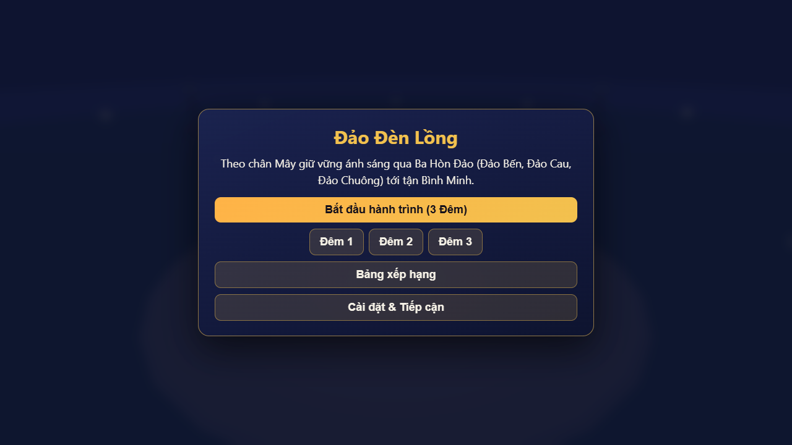
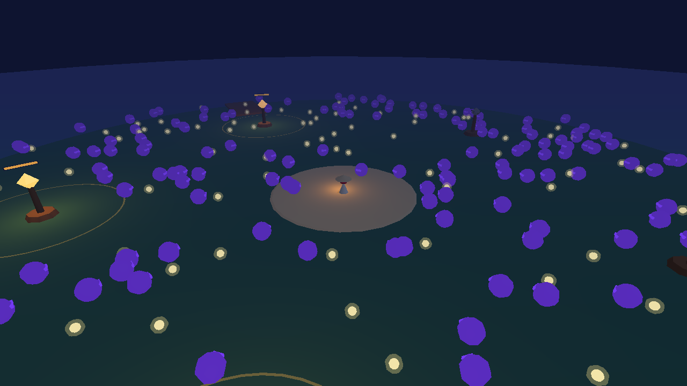

# Đảo Đèn Lồng — Bình Minh v1.0.0 (Day 12 AI SDLC)

> **Video demo (`.mp4` < 5 phút):** [Xem video demo tại Release v1.0.0](https://github.com/kegacua/K5-L3A-DAY12-LuuDangTuan-2A202603454-AI-SDLC-Dao-Den-Long/releases/tag/v1.0.0) *(hoặc `docs/demo/demo.mp4` sau khi đính kèm)*
> **Phiên bản:** `v1.0.0` · **Test Contract:** `v1.3` · **Tag các phase:** `phase-1` · `phase-2` · `phase-3` · `phase-4`

**Đảo Đèn Lồng** là game 3D góc nhìn thứ ba: điều khiển **Mây** (đội nón lá treo đèn lồng nhỏ) qua Ba Hòn Đảo (**Đảo Bến**, **Đảo Cau**, **Đảo Chuông**), thu thập đom đóm, thắp & **châm dầu giữ đèn sáng tới bình minh**, xua **Bóng Mực** bằng **Tỏa Sáng**, né **Gió Lạc** và **Gió mạnh**.




---

## Yêu cầu hệ thống & Cài đặt, Chạy nhanh (≤ 3 lệnh)

- **Hệ điều hành:** Linux, macOS hoặc Windows.
- **Yêu cầu:** **Node.js ≥ 20** (`node -v`). *(Benchmark 3D tự động cần Chrome/Chromium hoặc Edge).*

```bash
git clone https://github.com/kegacua/K5-L3A-DAY12-LuuDangTuan-2A202603454-AI-SDLC-Dao-Den-Long.git && cd K5-L3A-DAY12-LuuDangTuan-2A202603454-AI-SDLC-Dao-Den-Long
npm ci && npm run build
node dist/app.mjs
```

> Hoặc chạy bản đóng gói phát hành (`dao-den-long-v1.0.0.zip` trong Release `v1.0.0`): giải nén rồi chạy `node app.mjs` (hoặc mở thư mục `web/` bằng `npx serve .` / `python3 -m http.server 8080`). Hoặc chạy bằng Docker: `docker build -t dao-den-long . && docker run -p 4173:4173 dao-den-long`.

---

## Điều khiển & Tính năng tiếp cận

*(Mọi phím đều đổi được trong **Cài đặt & Tiếp cận**, có cảnh báo trùng phím và nút Khôi phục mặc định.)*

| Phím mặc định | Chức năng |
|---|---|
| `W` `A` `S` `D` / Mũi tên | Di chuyển Mây (`6.0 m/s`, `7.2 m/s` khi có Bùa Gió) |
| `Space` | Nhảy (`7.0 m/s`, trọng lực `-20 m/s²`) |
| `Shift` | **Lướt (Dash)** — `14 m/s` trong `0.2 s`, hồi `1.5 s` (`0 s` khi có Bùa Gió) |
| `E` | Nạp đom đóm thắp đèn mới (`10`), thắp lại (`5`), hoặc **châm dầu** đèn sáng (`+10` dầu/đom đóm) |
| `F` hoặc `Q` | **Tỏa Sáng** — tốn `3` đom đóm, bán kính 3D `5 m`, choáng `120` tick & đẩy `4 m` |
| `Esc` hoặc `P` | Tạm dừng / Tiếp tục (đóng băng toàn bộ thời gian, nhiên liệu, hồi chiêu & sinh thực thể) |
| Kéo chuột hoặc `J` / `L` | Xoay camera 3D |

- **Tiếp cận (Accessibility):** Cỡ chữ tối thiểu `18px` ở `1280×720`, tùy chọn **Chữ lớn (×1.25)**, **Bảng màu dễ phân biệt (Mù màu)** (`#00B3FF` cho Bóng Mực, `#FFFFFF` + `⚠`, đèn tắt xẹp 20% + vết rách giấy), **Giảm chuyển động**, cùng phụ đề & chỉ báo hướng Bóng Mực/gió/đèn yếu/10s cuối.
- **Bảng xếp hạng cục bộ (Top 10):** Lưu tên `3–12` ký tự sau màn hình Bình Minh hoặc khi thua, lưu bền vững ra đĩa (`~/.dao-den-long/leaderboard.json`). Xuất JSON: `node dist/app.mjs --export-leaderboard out.json`.

---

## Cách tính điểm (sau Phase 3 · Contract v1.3)

- **Thắng Đêm:** Sống sót tới bình minh (`240 / 270 / 300 s`) với ít nhất `ceil(0.6 × tổng đèn)` đang sáng (**3/5** Đêm 1, **4/6** Đêm 2, **5/7** Đêm 3) → `dawn_survived`.
- **Điểm:** `+5` mỗi đom đóm nạp/châm dầu · `+100` thắp lần đầu · `+40` thắp lại · `+5` Tỏa Sáng Bóng Mực thường / **`+15`** nếu đang hút dầu `drain` · Bình minh (khi thắng): `+50 + floor(fuel)` mỗi đèn sáng + `+50` mỗi Ngọn Lửa còn lại.

---

## Kiểm thử, Headless, Benchmark & Soak Test

```bash
# Chạy toàn bộ test (kiến trúc, unit, Contract v1.3 CLI, leaderboard/bench/soak)
npm test

# Chạy chế độ Headless (Contract v1.3)
node dist/headless.mjs --seed 42 --night 1 --ticks 600 --out out.jsonl --snapshot-every 10

# Chạy Benchmark 1280x720 chuẩn Ticket-04 (200 Bóng Mực + 100 đom đóm, 30s)
node dist/bench.mjs --seed 42 --duration 30 --out bench.json

# Chạy Soak Test 10 Đêm xoay vòng trong cùng tiến trình
node --no-opt --expose-gc dist/soak.mjs --seed 7 --nights 10 --out soak.json

# Chạy cổng kiểm chứng đầy đủ + lưu log thật
npm run verify -- --phase phase-4
```

> **Lưu ý về VSync trong Benchmark WebGL:** `dist/bench.mjs` khởi chạy Chromium/Edge với cờ `--disable-gpu-vsync --disable-frame-rate-limit` (`vsync_off: true`). Nếu chạy trực tiếp trên trình duyệt người dùng không có cờ này, bộ tổng hợp cửa sổ hệ điều hành có thể khóa FPS theo tần số quét màn hình.

---

## Sáng tạo của tôi (không ảnh hưởng Headless / Benchmark)

Toàn bộ phần sáng tạo chỉ nằm ở lớp hiển thị & âm thanh `src/client/` (được kiểm tra tách biệt bởi `tests/architecture.test.ts` và tự động tắt trong chế độ `?bench=1` cũng như `src/headless/`):
- **Nhạc nền ngũ cung & bộ SFX Web Audio API (`src/client/audio.ts`):** nhạc nền đêm dịu nhẹ và đầy đủ hiệu ứng (nhặt, nạp, châm dầu, thắp đèn, tắt đèn, tỏa sáng, nhảy, lướt, bùa, bị đánh, Bóng Mực xuất hiện, Gió Lạc cướp, gió, đếm ngược 10s, thắng/thua).
- **Lời dẫn Ông Đăng & lá bay báo gió:** hộp thoại cốt truyện đầu mỗi Đêm và hiệu ứng lá vàng bay theo hướng gió báo trước 2 giây trên Đảo Chuông.

---

## Tài liệu, Bằng chứng & Harness AI

- **Khai báo Contract v1.3 & Kết quả đo đã commit:** [game.contract.json](game.contract.json) · [bench.json](bench.json) · [soak.json](soak.json)
- **Bảng truy vết 4 Phase & Bằng chứng thật:** [docs/proof/README.md](docs/proof/README.md) · [phase-4-verify.log](docs/proof/phase-4-verify.log)
- **ADR, Giả định, Nhật ký AI & Retro:** [adr-001](docs/notes/adr-001-lantern-fuel-and-dawn-win.md) · [assumptions.md](docs/notes/assumptions.md) · [ai-log.md](docs/notes/ai-log.md) · [retro.md](docs/notes/retro.md)
- **Harness AI:** [AGENTS.md](AGENTS.md) · [.agents/skills/verify-phase/SKILL.md](.agents/skills/verify-phase/SKILL.md) · [.githooks/pre-commit](.githooks/pre-commit) · [.github/workflows/ci.yml](.github/workflows/ci.yml)
- **Pháp lý & Thay đổi:** [LICENSE](LICENSE) · [CREDITS.md](CREDITS.md) · [CHANGELOG.md](CHANGELOG.md)
